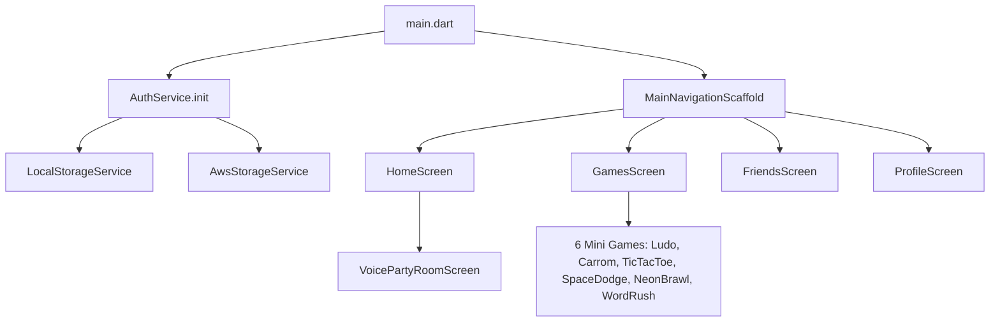

# Play Friends — AI Code Audit & Bug Finding Guide

This repository contains the complete source code of **Play Friends**, an Android-first social gaming and voice party room application built with **Flutter 3.x (Dart 3.x)** and native **Kotlin/Android**.

---

## 🎯 Purpose of This Package
This clean source archive is prepared for automated and AI-assisted code auditing, security review, and bug analysis.

---

## 🏗️ Architecture Overview



### Key Modules:
1. **`lib/services/auth_service.dart`**:
   - Manages user authentication, registration with security IDs starting with `01`, admin accounts, and match progress.
   - Saves/loads state to offline storage and syncs with AWS Cloud Storage / DynamoDB.
2. **`lib/services/local_storage_service.dart`**:
   - Interfaces via MethodChannel with Android's native `SharedPreferences` (`play_friends_storage`) to persist user profile, base64 photo, custom uploaded songs, and user-created rooms across complete app restarts and phone reboots.
   - Includes memory fallback for headless testing environments.
3. **`lib/services/in_app_music_service.dart` & `phone_media_picker_service.dart`**:
   - Synthesizes procedural melody loops for ambient game music and routes phone MP3 playback via native Android `MediaPlayer`.
4. **`lib/services/privacy_filter_service.dart`**:
   - Strict room chat regex filter blocking personal contact leaks (phone numbers, email addresses, external social handles like Instagram, Facebook, WhatsApp, Telegram, Snapchat).
5. **`lib/services/voice_room_manager.dart`**:
   - Room admin permissions (only Host and designated admins can play or change music).
   - Following system for rooms and players.
6. **`lib/screens/voice_party_room_screen.dart`**:
   - Voice room lobby featuring responsive top bar (`FittedBox` + `ConstrainedBox`), 10 custom theme atmospheres, interactive vinyl player, animated gifts, and multi-game launcher.
7. **`lib/screens/rooms_screen.dart`**:
   - Allows users to enter custom room names, select capacity scaled by level (Level 1 = 100, Level 50 = 1000+), and create persistent rooms.
8. **`android/app/src/main/kotlin/com/playfriends/play_friends/MainActivity.kt`**:
   - Native platform channels for high-performance sound playback, native file picking (`pickPhotoFromGallery`, `pickMusicFromStorage`), internal `filesDir` file persistence, `SharedPreferences` disk storage, and clean background minimization (`minimizeApp`).

---

## 🔍 Specific Areas to Audit for Bugs

1. **State Persistence**:
   - Verify that all updates to `UserModel` (coins, XP, wins, unlocked games, profile photo) trigger `_persistState()` in `AuthService`.
   - Verify `LocalStorageService` error handling and JSON serialization in `UserModel.fromMap()` / `RoomModel.fromMap()`.
2. **UI & Layout Constraints**:
   - Check all `Row`, `Column`, and `Flex` widgets for potential `RenderFlex` overflows on small (320dp) or large (tablet) viewports.
   - Check `VoicePartyRoomScreen._buildTopHeader` and `_buildChatStream` for text wrapping and clipping.
3. **Audio & Media Management**:
   - Verify `MediaPlayer` lifecycle in `MainActivity.kt` (`onDestroy`, `stopMediaFile`, `release`) to prevent audio resource leaks.
4. **Game Logic & Win Conditions**:
   - Verify `LudoGameScreen`, `CarromGameScreen`, and `TicTacToeScreen` for turn switching, win conditions, and match result reporting.
5. **Privacy & Security**:
   - Verify that `PrivacyFilterService` cannot be bypassed with common obfuscation (spaces, dashes, special characters).
   - Verify email OTP expiry and registration verification logic in `AuthService`.

---

## 🧪 Testing Instructions
To run all 45 automated unit and widget tests:
```bash
flutter test
```
To run static analysis:
```bash
dart analyze lib test
```
